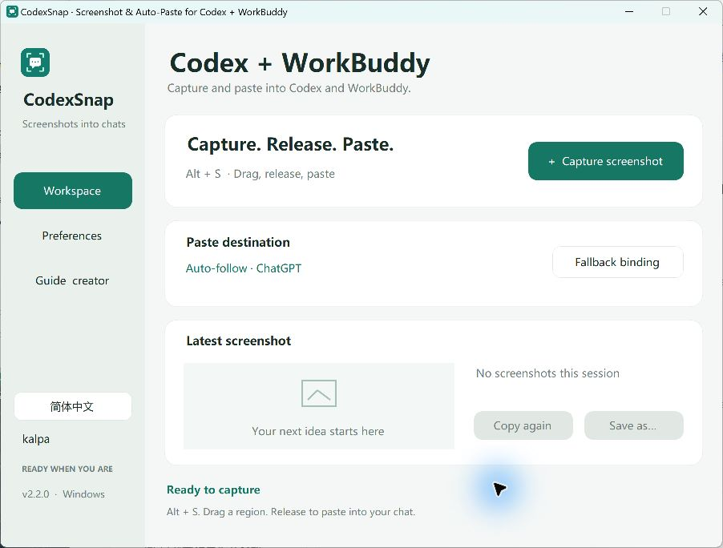
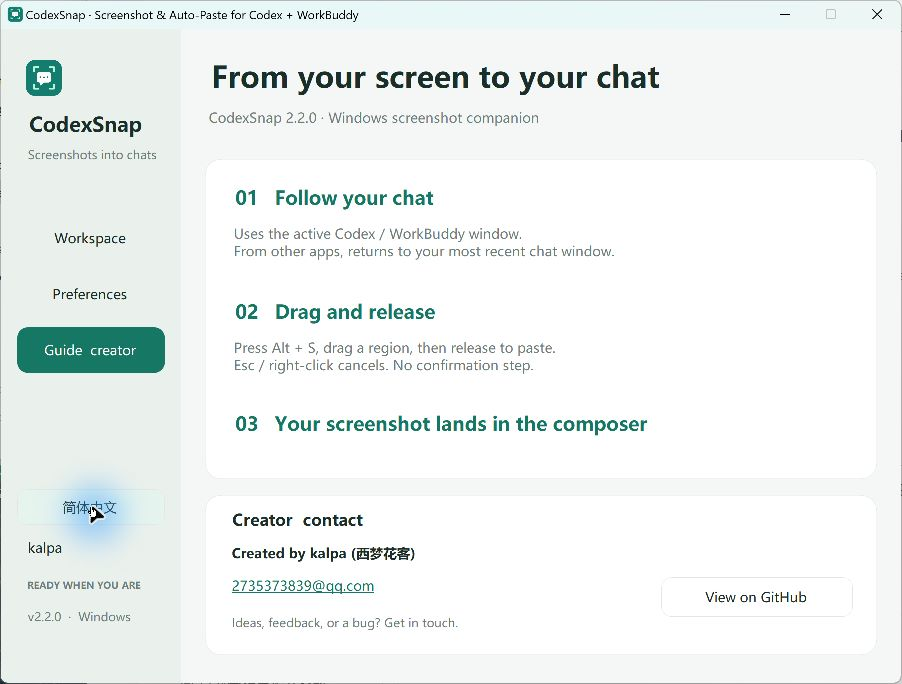

# CodexSnap — Screenshot & Auto-Paste for Codex and WorkBuddy

**English** · [简体中文](README.zh-CN.md)

**Alt + S → drag a region → release → paste into your chat.**

A lightweight Windows screenshot companion that brings errors, interfaces, and ideas directly into your Codex or WorkBuddy conversation.

**Created by kalpa / 西梦花客** · [2735373839@qq.com](mailto:2735373839@qq.com)

## Download and run

### [Download the Windows portable EXE · v2.2.0](https://github.com/148711/-CodexSnap/raw/refs/heads/main/CodexSnap.exe)

Download and double-click `CodexSnap.exe`. No Python, Node.js, or .NET SDK installation required; the app uses Windows' .NET Framework. The ready-to-run EXE is committed alongside its source. Verify it with [SHA256SUMS.txt](SHA256SUMS.txt).

1. Open a chat input in the Codex / ChatGPT desktop app or WorkBuddy.
2. Press **Alt + S** and drag to select a screen region.
3. **Release the mouse to capture and paste.** Add your question, then send when ready.

Right-click or press Esc to cancel. No Enter confirmation or success dialog.

## Screenshots





## What you can do

- **Capture and auto-paste:** follows the supported chat window active when you trigger the shortcut, or the most recently observed chat when capturing from another app.
- **English and Chinese UI:** switch in the sidebar; your choice persists across restarts.
- **Save original PNGs:** choose your folder. Paste happens before saving to reduce waiting.
- **Reuse the latest capture:** copy it again or save it as a file.
- **Stay ready in the tray:** close the window and keep your shortcut active. Launching the EXE again brings the workspace back.
- **Choose your shortcut:** Alt+S, Ctrl+Shift+S, or Ctrl+Alt+S, with conflict detection.
- **Fallback binding:** optionally remember an input position when automatic discovery is unavailable.

## Paste behavior and privacy

Images go into the composer; **messages are never submitted automatically**. WorkBuddy also documents clipboard image pasting in its [official guide](https://www.workbuddy.cn/docs/workbuddy/Conversation).

CodexSnap first looks for an accessible chat input. If an app does not expose one, it restores the app's existing input focus. Keep your chat composer open. Some app versions, layouts, or permission levels may require fallback binding or manual Ctrl+V. CodexSnap cannot verify whether an attachment upload completed.

CodexSnap itself does not upload screenshots. Pasting hands the image to your chat app, which handles it under its own behavior. By default, only the latest image stays in memory; disk saving is opt-in. Exiting clears the preview, but retains your clipboard and any saved files.

Settings and error logs live in `%LOCALAPPDATA%\CodexSnap`; logs do not contain screenshot content. The app runs without administrator privileges. Windows may block input to elevated apps. Mixed-DPI multi-monitor setups need device-specific validation. This EXE is currently unsigned.

## Build and test

```powershell
git clone https://github.com/148711/-CodexSnap.git
cd ./-CodexSnap
powershell -ExecutionPolicy Bypass -File .\build.ps1
powershell -ExecutionPolicy Bypass -File .\test.ps1
```

Builds use the .NET Framework C# compiler bundled with Windows. Icons and translations are embedded in the EXE. Python and Pillow are only needed to regenerate the icon with `make_icon.py`.

Tests cover release-to-capture, accidental clicks, cancellation, target recognition, composer filtering, language switching and settings migration, Unicode paths, PNG pixels, and atomic saving. Automated tests do not establish end-to-end compatibility with every target app version.

## Creator and feedback

I'm **kalpa (西梦花客)**. I built this tool to turn the small hassle of moving screenshots into chat into one fluid action. I hope it helps more people who use Codex and WorkBuddy.

- Email: [2735373839@qq.com](mailto:2735373839@qq.com)
- GitHub: [148711](https://github.com/148711)
- Bugs and ideas: [open an issue](https://github.com/148711/-CodexSnap/issues)

If it makes your workflow easier, share the repository or leave a Star to help others discover it.

This is an independent tool, not affiliated with OpenAI, Codex, or WorkBuddy. No open-source license has been selected yet; contact the author for redistribution or commercial licensing.
