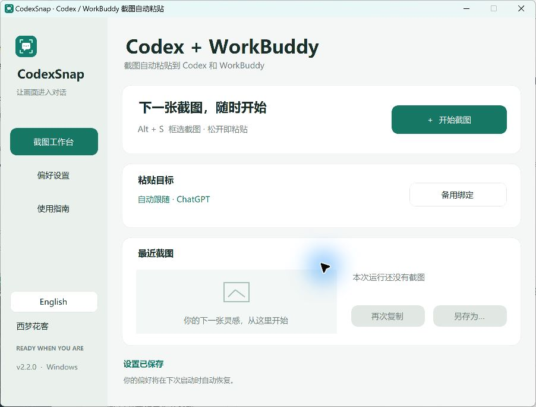
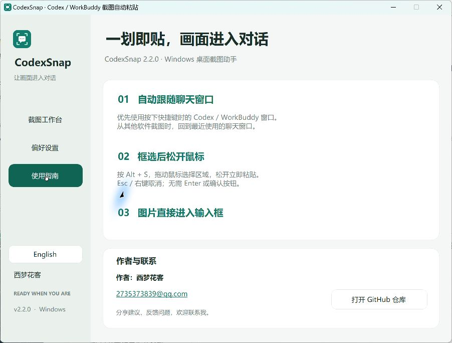

# CodexSnap — 为 Codex 和 WorkBuddy 截图并自动粘贴

[English](README.md) · **简体中文**

**Alt + S → 拖动框选 → 松开鼠标 → 图片进入聊天输入框。**

一个轻量的 Windows 桌面截图工具，帮你把报错、界面和灵感直接带进 Codex 或 WorkBuddy 的对话中。

**作者：西梦花客 / kalpa** · [2735373839@qq.com](mailto:2735373839@qq.com)

## 下载即用

### [下载 Windows 便携版 EXE · v2.2.0](https://github.com/148711/-CodexSnap/raw/refs/heads/main/CodexSnap.exe)

下载后双击 `CodexSnap.exe`，无需安装 Python、Node.js 或 .NET SDK。程序使用 Windows 的 .NET Framework。EXE 已提交到本仓库，与对应版本源码一同提供；可用 [SHA256SUMS.txt](SHA256SUMS.txt) 校验。

1. 打开 Codex / ChatGPT 桌面应用或 WorkBuddy 的聊天输入框。
2. 按 **Alt + S**，拖动鼠标框选要分享的内容。
3. **松开鼠标就完成截图并粘贴**。随后可以继续补充问题，再自行发送消息。

右键或 Esc 取消。没有 Enter 确认步骤，成功后不弹确认提示。

## 界面截图





## 你可以做什么

- **截图自动粘贴**：优先回到触发快捷键时正在使用的 Codex / WorkBuddy；从其他应用截图时，使用最近观察到的受支持聊天窗口。
- **中英文界面**：侧栏一键切换 English / 简体中文，重启后记住选择。
- **原图保存**：选择保存目录，自动保存 PNG；先粘贴，再保存，减少等待。
- **最近截图**：再次复制、另存为，不必重新截一次。
- **托盘常驻**：关闭窗口后继续响应快捷键；重复运行 EXE 可唤回工作台。
- **可选快捷键**：Alt+S、Ctrl+Shift+S 或 Ctrl+Alt+S，冲突时给出提示。
- **备用绑定**：自动定位不适用时，可绑定一个聊天输入位置。

## 关于粘贴与隐私

截图只进入输入框，**不会自动提交消息**。WorkBuddy 的图片粘贴方式也可参考其[官方说明](https://www.workbuddy.cn/docs/workbuddy/Conversation)。

助手优先寻找可访问的聊天输入控件；目标应用没有暴露控件时，恢复原有输入焦点。请确保目标应用正在显示聊天输入框。某些版本、布局或权限状态下可能需要备用绑定或手动 Ctrl+V；程序不能验证附件是否上传成功。

CodexSnap 本身不上传截图。粘贴后图片由目标聊天应用处理。默认仅在内存中保留最近一张；启用保存后才写入所选目录。退出会清除预览，剪贴板与已保存文件保留。

配置与错误日志位于 `%LOCALAPPDATA%\CodexSnap`，日志不记录截图内容。程序使用普通用户权限；管理员权限运行的目标应用可能阻止模拟输入。混合缩放的多显示器环境仍需要在相应设备上验证。当前 EXE 未进行代码签名。

## 构建与测试

```powershell
git clone https://github.com/148711/-CodexSnap.git
cd ./-CodexSnap
powershell -ExecutionPolicy Bypass -File .\build.ps1
powershell -ExecutionPolicy Bypass -File .\test.ps1
```

构建使用 Windows 自带的 .NET Framework C# 编译器。图标与翻译资源内嵌于 EXE。修改图标才需要 Python 和 Pillow，脚本为 `make_icon.py`。

测试包括松手完成、误点击保护、右键取消、目标识别、输入框筛选、语言切换与设置迁移、中文目录、PNG 像素和原子保存。自动化测试不代表所有目标应用版本的端到端粘贴均已验证。

## 作者与反馈

我是 **西梦花客（kalpa）**。我做这个工具，是希望把“截图再搬到聊天框”的小麻烦变成一个顺手动作，也希望它能帮助更多使用 Codex 和 WorkBuddy 的人。

- 联系邮箱：[2735373839@qq.com](mailto:2735373839@qq.com)
- GitHub：[148711](https://github.com/148711)
- 问题和建议：[提交 Issue](https://github.com/148711/-CodexSnap/issues)

如果它帮到了你，欢迎分享仓库链接，或点一颗 Star，让更多人找到它。

这是独立开发的工具，与 OpenAI、Codex 或 WorkBuddy 官方没有隶属关系。仓库尚未指定开源许可证；如需再分发或商用授权，请联系作者。
